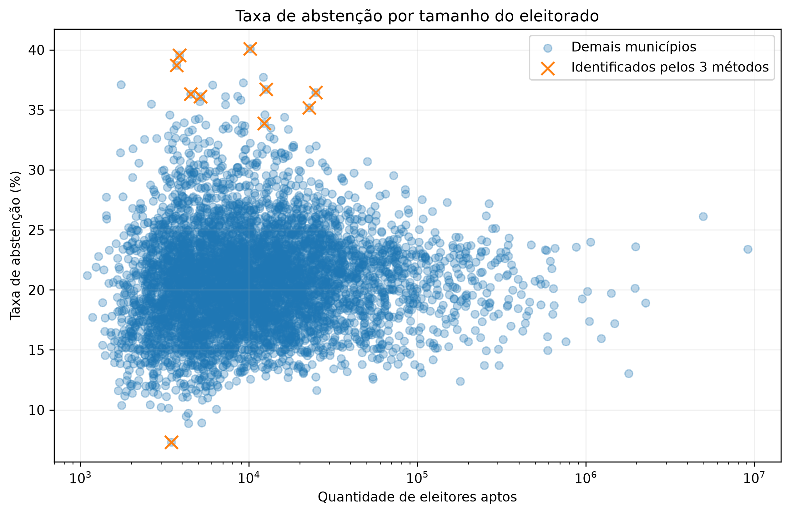
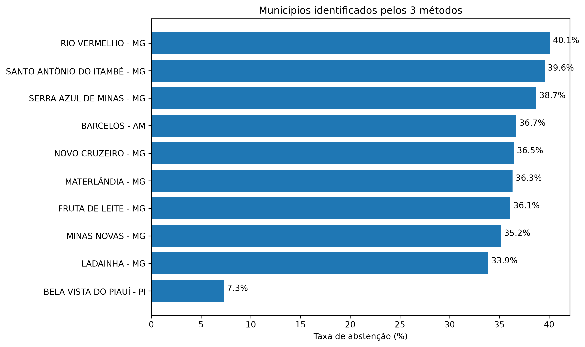

# Election Data Analysis 2026

Projeto de análise de dados eleitorais desenvolvido em Python com foco na identificação de comportamentos estatisticamente atípicos em municípios brasileiros.

## Objetivo

Analisar dados eleitorais públicos de 2026 e comparar diferentes métodos de detecção de outliers:

- IQR
- Z-score
- Isolation Forest

O objetivo não é identificar irregularidades eleitorais, mas detectar padrões estatisticamente incomuns que possam ser explorados em uma análise de dados.

## Tecnologias utilizadas

- Python
- Pandas
- Matplotlib
- Scikit-learn

## Etapas do projeto

1. Leitura dos dados
2. Tratamento e filtragem
3. Consolidação por município
4. Cálculo da taxa de abstenção
5. Separação por faixa de eleitorado
6. Detecção de outliers com IQR
7. Detecção de outliers com Z-score
8. Detecção de anomalias com Isolation Forest
9. Comparação entre os métodos
10. Geração de gráficos e arquivos de saída

## Principais resultados

Foram analisados 5.571 registros municipais.

Os métodos identificaram:

- IQR: 82 outliers
- Z-score: 37 outliers
- Isolation Forest: 112 anomalias

Ao comparar os métodos:

- 43 municípios foram identificados por pelo menos 2 métodos
- 10 municípios foram identificados pelos 3 métodos

  ## Visualizações

### Distribuição da taxa de abstenção



### Municípios identificados pelos 3 métodos



## Observação

Um município classificado como outlier ou anomalia não representa, por si só, qualquer irregularidade.

O resultado indica apenas que o comportamento estatístico daquele município se diferencia do padrão observado nos dados analisados.

## Estrutura

```text
election-data-analysis/
├── data/
├── outputs/
├── main.py
├── requirements.txt
├── .gitignore
└── README.md
